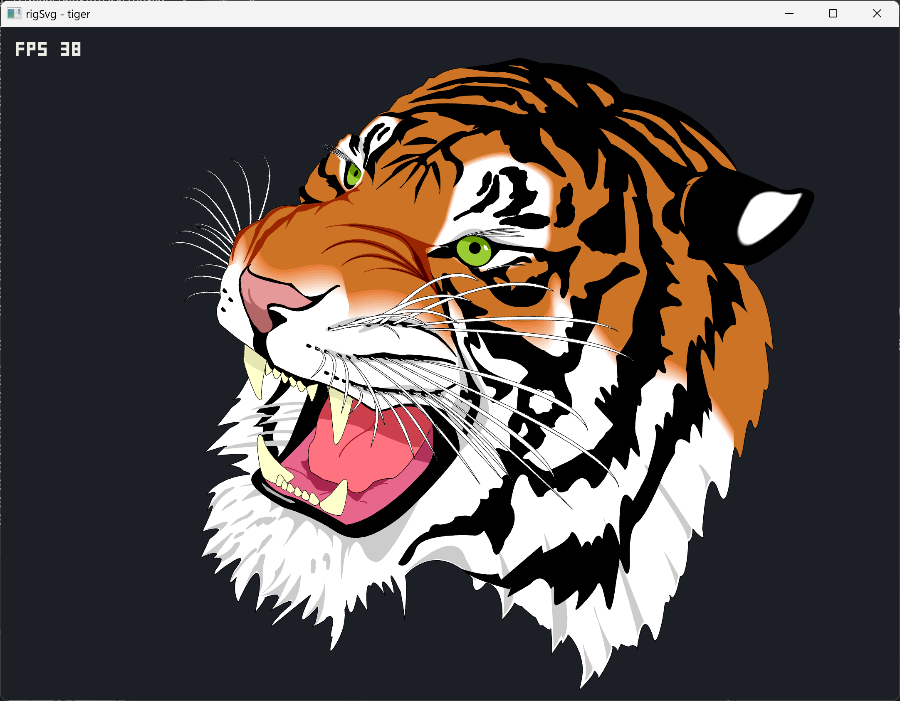

# rigSvg



SVG to `ParsedPathDoc` - layers of `CPaths` plus the doc `CPaintLibrary`.

**Import:** `path` (M/L/H/V/C/S/Q/T/A/Z - arcs stay A, smooth S/T), `line`, `rect`,
`circle`, `ellipse`, `polyline`, `polygon`, nested `g` layers, `transform`, root
`viewBox`, fill/stroke colours, `stroke-width`, `<linearGradient>` /
`<radialGradient>` via `url(#...)`.

**Export:** groups per layer, solid fill/stroke, gradient defs (OkLab/HSV densify
to sRGB stops; intensity bakes in linear light and clamps), analytic `A`.

Depends on **rigPlotComponent**.

When a host `IMui` is attached, the pack registers a `.svg` file-browser Icons decoder (NanoSVG CPU raster). Import/export is still `loadFile` / `writeFile`.

```cpp
rigkit::plot::ParsedPathDoc doc;
rigkit::svg::loadFile(path, doc);
rigkit::svg::writeFile(doc, outPath, paperWmm, paperHmm);
```

[API/docs](https://rigkid.github.io/rigSvg/)
